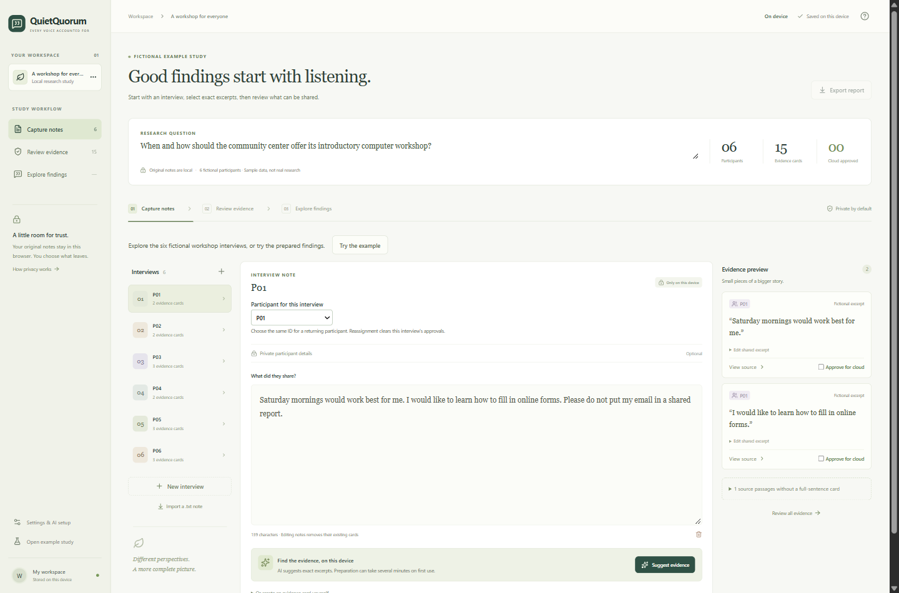
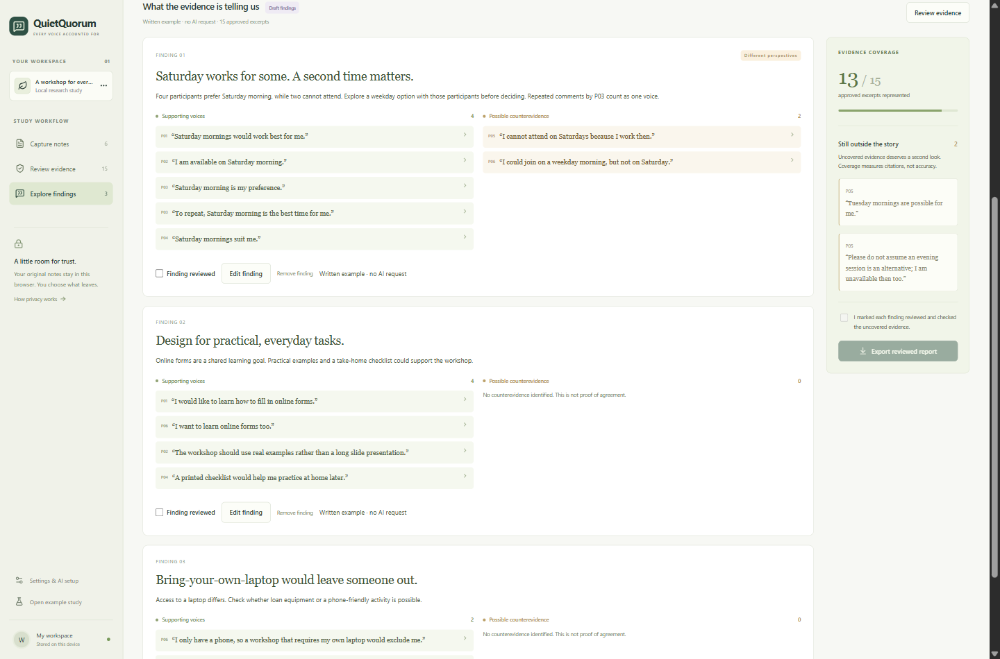
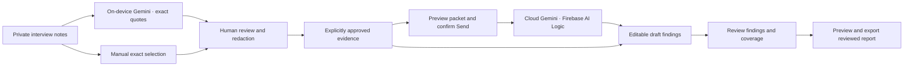

# QuietQuorum

Four people prefer Saturday. Two cannot attend. QuietQuorum helps community organizers, nonprofit researchers and consultation facilitators see both groups, trace a finding to its source, and decide what evidence can leave the device.

**[Open QuietQuorum](https://quietquorum-358a5.web.app/) · [Engineering readiness](HACKATHON_READINESS.md) · [Demo walkthrough](docs/demo/README.md)**



## Try it in two minutes

1. Open the live app and choose **Try the example**. Six fictional interviews are already loaded.
2. Choose **Approve example excerpts**, inspect **Review cloud payload**, then go back. **View example findings** opens the written demonstration without using AI. **Send approved payload** runs actual cloud synthesis when configured and online.
3. In the written example, open a Saturday citation. Five supporting quotes come from four people. Two other people cannot attend. Inspect the approved excerpts outside the findings.
4. Choose **Edit finding** to change wording or classify a citation. Review each finding, then confirm the overall review. Choose **Export reviewed report** to preview printable HTML or JSON. Open downloaded HTML and use Print to save a PDF.



## Hybrid inference



React, TypeScript and Vite run on Firebase Hosting. IndexedDB holds the workspace. Firebase AI Logic handles both inference paths, with App Check on the cloud service. The runtime enforces local-only processing for original notes and verifies the SDK's reported inference source. Distinct participant counts come from stable pseudonyms. A researcher can link return interviews, correct citations, record uncertainty and review overlapping positions. [Architecture](ARCHITECTURE.md)

## Run locally

Use Node 24. The written example and manual analysis require no Firebase credentials.

```sh
npm ci
npm run dev
npm test
npm run build
npm run preview
```

For live inference, copy `.env.example` to ignored `.env.local`, configure your Firebase web app and enable AI Logic with App Check. Register your hosting domains with reCAPTCHA Enterprise. Use a registered local debug token only for development. The production bundle must never contain a private model key or debug token. [Setup](docs/development.md) · [Testing](TESTING.md)

The production service worker supports offline capture, correction and report review after an online visit. Local AI also needs a compatible desktop Chrome installation and downloaded model. Firebase documents Chrome 139+ for its web hybrid SDK. Chrome specifies at least 22 GB of free profile-volume storage and either more than 4 GB of GPU memory or at least 16 GB RAM and four CPU cores. In Settings, check model availability and prepare it while online. Manual cards remain available on unsupported devices. [Firebase hybrid guide](https://firebase.google.com/docs/ai-logic/hybrid/web/get-started) · [Chrome requirements](https://developer.chrome.com/docs/ai/get-started)

## Evidence and limitations

The readiness suite passed 61 automated checks and 16 browser workflow checks, with an additional network-blocked reload. In 22 held-out fictional scenarios, 43 local calls returned 44 verbatim quotes. One target was bundled with irrelevant text. Twenty-five successful cloud calls used valid citations throughout. Six additional attempts hit rate limits. One result cited a minority constraint without explaining it in the finding prose. The source links and correction workflow give the researcher a way to address these errors. [Evaluation, raw results and comparison](docs/evaluation/readiness.md)

Browser storage is unencrypted. Redaction and participant linking depend on the researcher. A valid source ID establishes provenance, and interpreting the evidence still requires human review. Time savings, user adoption and general model accuracy have not been established. [Privacy](PRIVACY.md) · [Security](SECURITY.md) · [Prospective-user protocol](docs/demo/usability.md)

## Project

The [Devpost entry](https://devpost.com/software/quietquorum) is a draft. The submission state and outstanding declarations are recorded in the [handoff](docs/continuation.md). Source is available under the [MIT license](LICENSE). [Contributing](CONTRIBUTING.md)
